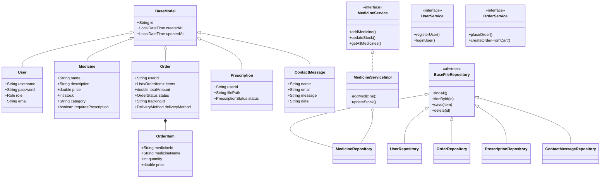

# Med+ Project Technical Report

## 1. Project Overview
Med+ is a comprehensive Online Medical Store management system designed to handle the complex workflow of pharmaceutical retail. It facilitates interactions between Customers, Pharmacists, and Administrators, ensuring secure medicine distribution and prescription verification.

## 2. System Architecture
The system follows a standard **MVC (Model-View-Controller)** architecture implemented with Spring Boot, fully adhering to **SOLID Principles**:
*   **Model**: Represents the data structures (Users, Medicines, Orders, etc.).
*   **View**: Server-side rendered JSP pages providing the user interface.
*   **Controller**: Handles user requests, interacts with services via Constructor Injection (Dependency Inversion Principle), and returns views.
*   **Service**: Interfaces (e.g., MedicineService, OrderService) encapsulating business logic (Interface Segregation Principle).
*   **Repository**: Custom file-based data persistence using JSON.

## 3. Class Diagram

## 4. Key Features
*   **Role-Based Access**: Secure dashboards for Admin and Pharmacist roles.
*   **Prescription Workflow**: Automated hold on prescription-required medicines until pharmacist approval.
*   **Custom Persistence**: Zero-dependency JSON storage for lightweight deployment.
*   **Modern UI**: Responsive design using Poppins typography and a cohesive medical color palette.

---
**Contact:** SLIIT, Malabe, Sri Lanka | **Phone:** +94112000000 | **Email:** support@medplus.lk
